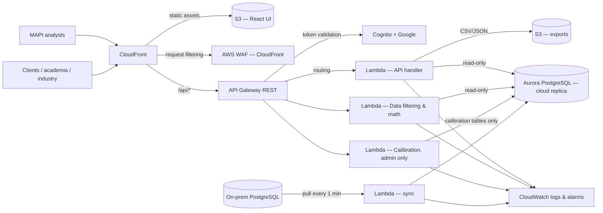

# AWS Architecture — Sea Level Dashboard

Implements the architecture approved with the company's AWS architect on **12.08.2025**
(`AWS architecture 12.08.2025.pdf`). Region: **il-central-1 (Tel Aviv)**. Everything is defined in
[`infra/template.yaml`](../../infra/template.yaml) (+ [`infra/cloudfront-waf.yaml`](../../infra/cloudfront-waf.yaml), us-east-1).

## Component-by-component alignment with the architect's diagram

| Architect's component | Implementation | Notes |
|---|---|---|
| MAPI Analysts / Academia & Industry → browser | Google sign-in for everyone; who may sign in is an allowlist in SSM (`/sealevel/<env>/allowed-users`) | "Public access (optional)" = add a client domain/address to the allowlist. No anonymous data access. |
| CloudFront | `Distribution` — S3 origin (OAC) + `/api/*` → API Gateway, security headers, SPA routing function | `/api/*` is never cached. |
| Static React UI (S3 hosted) | `FrontendBucket` — private, encrypted, versioned, CloudFront-only | |
| AWS WAF (Request Filtering) | `cloudfront-waf.yaml` (us-east-1, attached to CloudFront) **and** `ApiWaf` on the API stage | API WAF also blocks any request that did not come through CloudFront (`x-origin-verify`). |
| API Gateway (REST interface) | `Api` — REST, regional, throttling, access logs, Cognito authorizer | |
| Cognito (Access Control) — "will integrate with CRM" | `UserPool` + Google IdP + `AccessFunction` trigger (PreSignUp + PreTokenGeneration) | The allowlist check in `lambdas/cognito_access` is the single place to plug in the CRM later. |
| Lambda (API Handler) | `ApiFunction` — FastAPI (`backend/app.py`) via Mangum | Read-only DB user. |
| Lambda (Data Filtering & Math), read-only access | `DataMathFunction` — `/api/analytics`, `/api/predictions`, `/api/outliers*` | Same code image, separate function, read-only DB user, more memory. |
| ElastiCache (Redis) — **dropped 12.08.2025 (low user count)** | Not deployed. `REDIS_ENABLED=false` on Lambda. | Code still supports Redis if it is added later. |
| S3 Bucket (Downloadable Exports) | `ExportsBucket` + `GET /api/export` (CSV/JSON → presigned URL, 15 min) | Files expire after 2 days. |
| CloudWatch Logs & Alarms | Log groups, API access logs, alarms → SNS email | Sync failure, API 5xx, calibration errors, Aurora capacity. |
| Amazon Aurora PostgreSQL (Cloud Replica) | `AuroraCluster` — Serverless v2, encrypted, backups, deletion protection (prod) | |
| On-prem PostgreSQL → Lambda/DMS → pull every 1 min → sync | `SyncFunction` — EventBridge `rate(1 minute)`, reserved concurrency 1 | Needs the VPN / Direct Connect route to on-prem. DMS remains an option (see DEPLOYMENT.md). |

## Additions not in the diagram (and why)

| Addition | Why |
|---|---|
| **Calibration Lambda** (`CalibrationFunction`), admin only | Calibration writes data; it runs with its own DB user that can write *only* the calibration tables. |
| **Cloud-owned calibration layer** (`Calibration_Offsets`, `Calibration_Audit*`, view `Monitors_effective`) | Aurora is a replica: corrections can't live in the replicated table or the sync would overwrite them. Every change is audited (who/when/what) and reversible. |
| **Three least-privilege DB users** (reader / calibrator / sync) | A compromised API cannot modify raw data. |
| **Migrate function** | Applies SQL migrations and creates DB users on every deploy — no manual DB steps. |

## Request flow (signed-in user)

1. Browser → CloudFront → S3 serves the React app. Not signed in → "Sign in with Google".
2. Cognito Hosted UI → Google → Cognito checks the allowlist (trigger) → returns tokens (PKCE, no client secret).
3. Browser calls `/api/...` with the ID token → CloudFront adds `x-origin-verify` → WAF → API Gateway validates the token → Lambda.
4. Lambda reads `Monitors_effective` (corrected values) with the read-only user.
5. Admin (benp@mapi.gov.il, verified) → `/api/calibration/*` → calibration Lambda → audited write to `Calibration_Offsets`.
